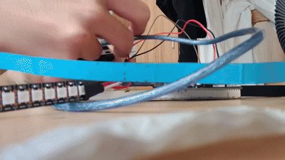
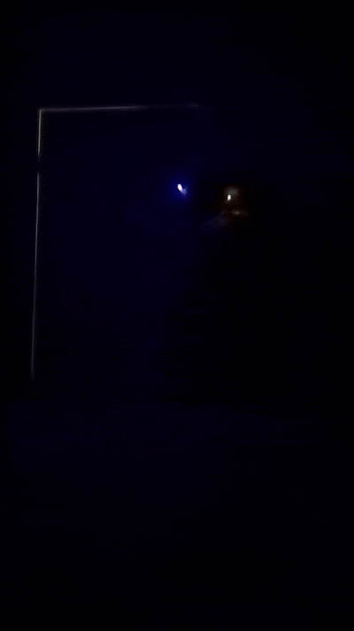

# Christmas-Tree-Hat-Saga
Coming Soon



# Description

This is an annual tradition of mine since 2024, where every year I take a hat that resembles a Christmas tree and then attach an Arduino to it. The point is not to make a prototype of a product but rather to have fun and build something. This repo acts as a "lab doc" of every design for the years to come, with this doc now being written in 2026. 

# Archive
# 2025
This year had new iterations to the more "structural" aspects of the design. To begin, the laptop has now been replaced with a portable battery, which improved on the clunky nature of the laptop. With the help of my AP Gov teacher (shout-out to Mrs. Smith), the issue of the hat toppling over was solved by placing a rod, such as a chopstick, to keep it upright; not to mention the battery usually being stuffed in as well. The breadboard was now vertically strapped onto the hat with rubber bands, and overall it was a consistent system.

In terms of reflection, a key design flaw was still the LEDs in themselves. The only way to connect them was one wire per LED (common ground). The only alternative is N LEDs per wire if they are all attached to the same data pin. Furthermore, the only way to have the "Christmas light" wire look was if the LEDs were freely hanging, which was vulnerable to damage, and the alternative (breadboard) is not an ideal visual look. 

The design often required pit-stops in about 30-2 hour intervals due to some sort of failure (no redundancy or wires falling out)
The next design is to ideally have a clean look (fewer fasteners, but having them isn't inherently bad), and as few wires as possible to reduce system failure.

<table>
<tr>
<td>

</td>
<td>  </td>
</tr>
</table>

```cpp
int leds[] = {3, 5, 6, 9, 10};
int count = 5;
int brightness = 75;
bool dimMode = false;
int delayTime = 170;

void setup()
{
  if(dimMode)
  {
    brightness = 15;
    delayTime = delayTime;
  }
}

void sequentialWave(int cycles) {
  for (int c = 0; c < cycles; c++) {
    for (int i = 0; i < count; i++) {
      analogWrite(leds[i], brightness);
      delay(delayTime);
      analogWrite(leds[i], 0);
    }
  }
}

void dualChase(int cycles) {
  for (int c = 0; c < cycles; c++) {
    for (int i = 0; i < count; i++) {
      int j = count - 1 - i;
      analogWrite(leds[i], brightness);
      analogWrite(leds[j], brightness);
      delay(delayTime);
      analogWrite(leds[i], 0);
      analogWrite(leds[j], 0);
    }
  }
}

void pulseCenter(int cycles) {
  for (int c = 0; c < cycles; c++) {

    analogWrite(leds[2], brightness);
    delay(delayTime);
    analogWrite(leds[2], 0);

    analogWrite(leds[1], brightness);
    analogWrite(leds[3], brightness);
    delay(delayTime);
    analogWrite(leds[1], 0);
    analogWrite(leds[3], 0);

    analogWrite(leds[0], brightness);
    analogWrite(leds[4], brightness);
    delay(delayTime);
    analogWrite(leds[0], 0);
    analogWrite(leds[4], 0);
  }
}

void loop() {
 sequentialWave(2);    
  dualChase(3);         
  pulseCenter(3);    
}
```
# 2024

This is the first build that used a computer as a battery and dangled LEDs at the tip alongside the hat tilting downward. There are clear design issues, such as the wires often being strained from the fact that the computer has to be held decently high in order to prevent it. The code is also lost to time, but not too much reflection will be provided, as this was the very first iteration with a majority of the issues either being obvious or weeded out in the 2025 design.

<table>
<tr>
<td>

</td>
<td>  </td>
</tr>
</table>


